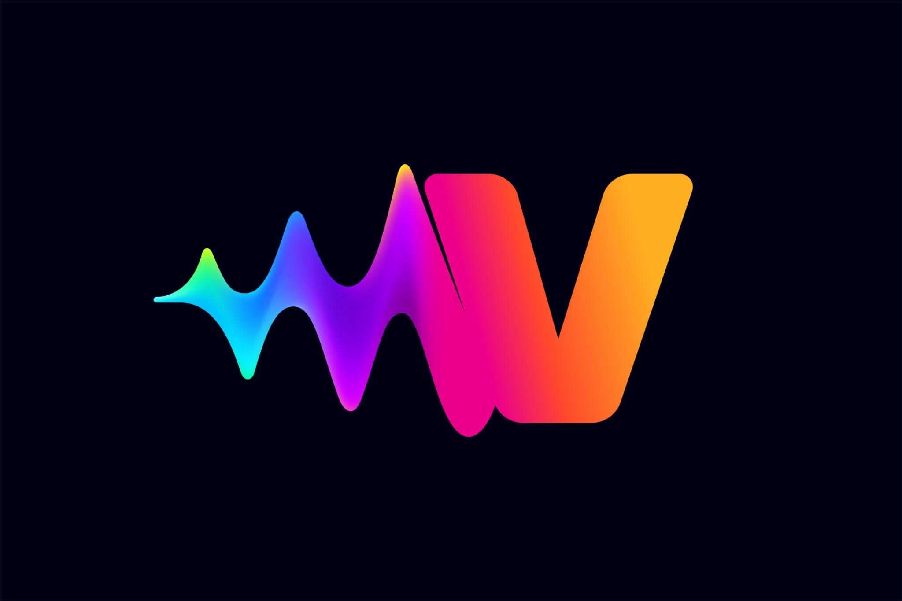
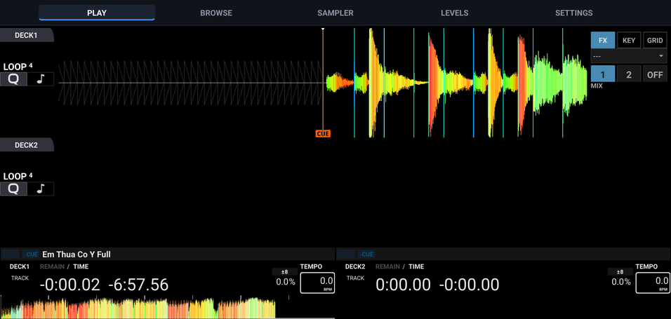

<p align="center">
  
</p>

<h1 align="center">Vynix DJ</h1>

<p align="center">
  Open-source DJ software for <b>Android</b>, built for touch screens and USB DJ controllers.<br>
  Also available for Windows, Linux and macOS. Based on <a href="https://mixxx.org">Mixxx</a>.
</p>

<p align="center">
  
</p>

> **Two decks.** Vynix DJ currently supports **2 decks**. Controllers with four decks
> work, but only decks 1 and 2 are shown and mixed in the interface.

---

## Features

- **Two decks** with colored waveforms (RGB / Filtered / HSV), beatgrids, cues, hot cues
  and loops.
- **Touch interface** that scales to phone and tablet screens and runs truly full screen,
  including the camera cutout (notch) area.
- **Two-finger pinch zoom** on the waveforms.
- **MIXER tab**: GAIN, tempo (BPM, pitch %, tempo fader), channel faders, LOW / MID / HI
  EQ and filter faders, master VU meter, CUE / PLAY / SYNC and crossfader.
- **Music library** from device storage (`Music`, `Download` or any folder you add), with
  search and a track info panel: cover art, BPM, key, duration, overview waveform and
  LOAD 1 / LOAD 2 buttons.
- **Rekordbox USB drives**: reads playlists, cues, loops and beatgrids from USB drives
  exported with Rekordbox. Rekordbox and Serato are listed right after Tracks.
- **Hardware-style Beat FX**: pick an effect from a full-screen picker, toggle it on/off,
  set the BEAT and LEVEL knobs. Includes Echo, Reverb, Flanger, Phaser, Filter, Trans,
  Pan, Glitch, Pitch, Bitcrusher and Noise. Choose one FX unit (DDJ style) or two
  (Denon DJ / Numark style).
- **USB MIDI controllers** through the Android MIDI API: controllers are detected and a
  mapping is picked automatically from the 140+ mappings that ship with Mixxx
  (Pioneer DDJ, Denon MC, Numark, Hercules, Roland, …).
- **Controller-first browsing**: turning the browse knob opens the library, loading a
  track returns to the decks, so a set can be played without touching the screen.
- **USB HID / Bulk controllers** (some Traktor, Hercules, Denon, … models).
- **Touch-friendly settings**: in-app settings pages, plus the full Preferences dialog
  with large text and swipe scrolling.

## Requirements

- **Android:** Android 9 (API 28) or later, **arm64-v8a** CPU.
  **All files access** permission to read your music library, and a **USB OTG** cable
  or adapter to connect a DJ controller.
- **Windows:** Windows 10 or later, 64-bit.
- **Linux:** Debian / Ubuntu based distributions, x86_64 or ARM64.
- **macOS:** macOS 11 or later, Apple Silicon (M1 or later).

## Installation

Download the package for your platform from the
[Releases](https://github.com/thanhtonvk/Vynix-DJ/releases) page:

| Platform | File |
|---|---|
| Android | `VynixDJ-<version>-android-arm64.apk` |
| Windows | `VynixDJ-<version>-windows-x64.zip` |
| Linux (PC) | `VynixDJ-<version>-linux-x64.deb` |
| Linux (ARM64, e.g. Raspberry Pi) | `VynixDJ-<version>-linux-arm64.deb` |
| macOS (Apple Silicon) | `VynixDJ-<version>-macos-arm64.dmg` |

**Android:** open the APK on your phone and allow installing apps from unknown sources,
or install it from a computer with `adb install VynixDJ-<version>-android-arm64.apk`.
Launch Vynix DJ and grant file access when asked.

**Windows:** unzip the archive and run `VynixDJ.exe`.

**Linux:** `sudo apt install ./VynixDJ-<version>-linux-x64.deb` (or the ARM64 package),
then start Vynix DJ from the applications menu.

**macOS:** open the DMG and drag **VynixDJ** to **Applications**. The app is not signed
with an Apple Developer ID, so macOS blocks it the first time: right-click the app →
**Open** → **Open**, or run `xattr -dr com.apple.quarantine /Applications/VynixDJ.app`.

## Quick start

**Adding music**

- Copy music into the phone's `Music` or `Download` folder; Vynix DJ scans both
  on first launch.
- To add another folder: **SETTINGS → DEVICE → Music library → OPEN → Add**.
- Open **BROWSE → TRACKS**, tap a track, then press **LOAD 1** or **LOAD 2**
  (or double-tap the track).

**Mixing** (**MIXER** tab)

- Faders for volume, LOW / MID / HI and filter, GAIN knobs, tempo, CUE / PLAY / SYNC
  and the crossfader for both decks.

**Beat FX** (**PLAY** tab, right panel)

1. Tap the effect name to open the picker, then choose an effect.
2. Select **Deck 1** / **Deck 2** to apply it to.
3. Press **FX ON**, then turn the **BEAT** and **LEVEL** knobs.
4. One or two FX units: **SETTINGS → GENERAL → FX units**.

**DJ controllers**

- Plug in the controller **before** launching the app. Controllers with a bundled
  mapping are enabled automatically.
- If you plug one in while the app is running, a notice asks you to restart the app.
- To choose a mapping manually: **SETTINGS → DEVICE → DJ controllers → OPEN**.

**Audio**

- The default output is the device speaker or headphones, via Oboe/AAudio.
- To change device, latency or sample rate: **SETTINGS → AUDIO → OPEN**.
- Master, booth and headphone levels and the master EQ are in **SETTINGS → AUDIO**.
- Sample players are in **SETTINGS → SAMPLER**.

## Building from source

### Android

Requirements: Linux x86_64 (or WSL 2 on Windows), CMake ≥ 3.22, Ninja, JDK 17,
Android SDK (platform 35, build-tools 35.0.0) and NDK 27.2.12479018.

```bash
# 1. Install the Android SDK/NDK and download the prebuilt (vcpkg) libraries for arm64-android
source tools/android_buildenv.sh setup

# 2. Create an APK signing key (only once)
keytool -genkey -keystore vynixdj.keystore -alias vynixdj -keyalg RSA \
        -keysize 2048 -validity 10000
export QT_ANDROID_KEYSTORE_PATH=$PWD/vynixdj.keystore
export QT_ANDROID_KEYSTORE_ALIAS=vynixdj
export QT_ANDROID_KEYSTORE_STORE_PASS=<password>
export QT_ANDROID_KEYSTORE_KEY_PASS=<password>

# 3. Configure and build
mkdir -p build && cd build
cmake -G Ninja \
      -DCMAKE_TOOLCHAIN_FILE=$MIXXX_VCPKG_ROOT/scripts/buildsystems/vcpkg.cmake \
      -DCMAKE_SYSTEM_NAME=Android \
      -DVCPKG_TARGET_TRIPLET=arm64-android \
      -DCMAKE_BUILD_TYPE=RelWithDebInfo \
      -DQT6=ON -DQML=ON -DHID=ON -DBULK=ON \
      -DBUILD_TESTING=OFF -DBUILD_BENCH=OFF \
      -DCMAKE_CXX_SCAN_FOR_MODULES=OFF \
      ..
cmake --build . --parallel

# The APK is written to:
# build/android-build/build/outputs/apk/release/android-build-release-signed.apk
```

The `setup` step needs `sudo` to install packages and downloads about 15 GB of
libraries. `-DCMAKE_CXX_SCAN_FOR_MODULES=OFF` is needed with CMake 3.28 and later, the
NDK has no `clang-scan-deps`.

### Windows, Linux and macOS

The Windows (x64), Linux (x64, ARM64) and macOS (arm64) packages are built by GitHub
Actions, see
[`.github/workflows`](.github/workflows). Pushing a `v*` tag builds all of them and
attaches them to the release. See [CONTRIBUTING.md](CONTRIBUTING.md) for building the
desktop version locally.

### Running on the Android emulator

The build is arm64 only. x86_64 emulator images running **Android 11 or later** can
still run it through ARM translation, but slower than a real device:

```bash
sdkmanager "system-images;android-34;google_apis;x86_64" "emulator"
avdmanager create avd -n vynix -k "system-images;android-34;google_apis;x86_64" -d pixel_8
emulator -avd vynix -gpu host &
adb install -r build/android-build/build/outputs/apk/release/android-build-release-signed.apk
```

## Differences from Mixxx

| Component | Main changes |
|---|---|
| `src/controllers/midi/androidmidi*` | New Android MIDI backend (`android.media.midi`) |
| `packaging/android/src/com/tondz/vynixdj/` | `MidiBridge` (MIDI), `StorageVolumes` (USB drives), `MainActivity` (full screen) |
| `src/util/androidlibccompat.c` | libc functions missing on Android 9–13 |
| `src/controllers/controllermanager.cpp` | Auto-enables new controllers and picks a mapping by name |
| `src/library/` | Controller-first browsing, search from the sidebar, Rekordbox / Serato first |
| `res/skins/VynixDJ/` | Touch skin, MIXER tab, FX picker, track info panel |
| `src/preferences/dialog/dlgpreferences.cpp` | Large-text Preferences with swipe scrolling |
| `src/widget/wwaveformviewer.cpp` | Two-finger pinch zoom |
| `src/effects/` | Beat FX knobs, `beat_period` control, BQ EQ as the default deck EQ |
| `src/soundio/` | Detects the built-in speaker, selects Oboe and a default output |

It also includes several fixes for Mixxx on Android: a crash on launch on Android 9–13,
empty waveforms, no audio output, Rekordbox USB drives not found, and effects and fonts
not loading from the APK assets.

## Known limitations

- Only **2 decks** are supported.
- Controllers with a built-in sound card (e.g. Denon MC7000) may only play the Master
  output; separate headphone cueing is not supported yet.
- Controllers plugged in while the app is running are only detected after a restart.

## Contributing

Vynix DJ is an independent project and is not part of the Mixxx development team.
Please report bugs and feature requests in [Issues](https://github.com/thanhtonvk/Vynix-DJ/issues),
**not** on Mixxx channels.

General Android fixes (not tied to the Vynix DJ interface) may be contributed back to
Mixxx following the process in [CONTRIBUTING.md](CONTRIBUTING.md).

## Credits

- **[Mixxx](https://mixxx.org)**: audio engine, library, controller mappings and the
  whole foundation. © Mixxx Development Team.

"Mixxx" is a trademark of the Mixxx project. Vynix DJ is an independent derivative and
is not endorsed or sponsored by the Mixxx project.

## License

Vynix DJ is released under the **GNU General Public License, version 2 or later**,
like Mixxx. See [LICENSE](LICENSE) and [COPYING](COPYING). The license and copyright
notices of the VynixDJ skin are in [`res/skins/VynixDJ/LICENSE`](res/skins/VynixDJ/LICENSE).
