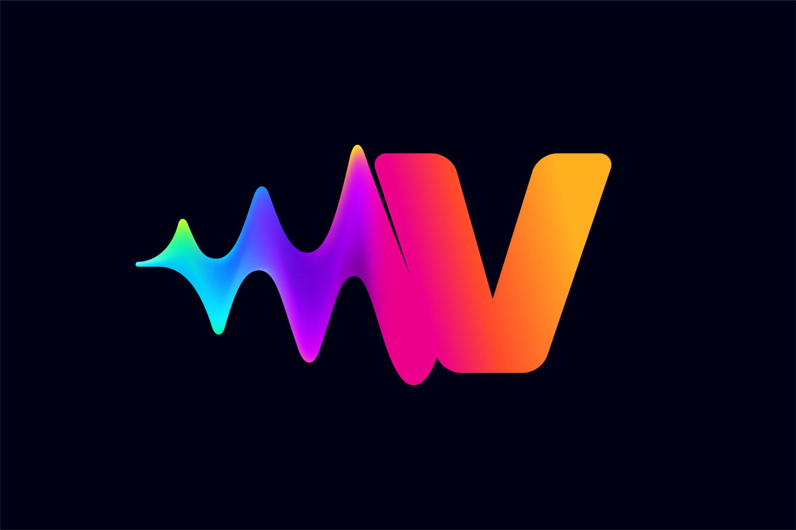
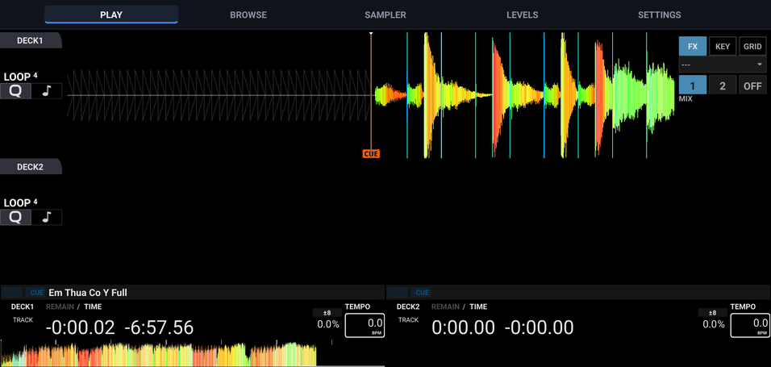

<p align="center">
  
</p>

<h1 align="center">Vynix DJ</h1>

<p align="center">
  Open-source DJ software for <b>Android</b>, built for touch screens and USB DJ controllers.<br>
  Based on <a href="https://mixxx.org">Mixxx</a>.
</p>

<p align="center">
  
</p>

> **Status: experimental.** The app runs on the Android emulator but has not yet been
> fully tested on real phones or real DJ controllers. Do not rely on it for live gigs yet.

---

## Features

- **Two decks** with colored waveforms (RGB / Filtered / HSV), beatgrids, cues, hot cues and loops.
- **Touch interface** based on the Bite DJ skin. It scales to phone and tablet screens
  and runs truly full screen, including the camera cutout (notch) area.
- **Two-finger pinch zoom** on the waveforms.
- **Music library** from device storage (`Music`, `Download` or any folder you add),
  with a track info panel: cover art, BPM, key, duration and overview waveform.
- **Rekordbox USB drives**: reads playlists, cues, loops and beatgrids from USB drives
  exported with Rekordbox.
- **Hardware-style Beat FX**: pick an effect from a full-screen picker, toggle it on/off,
  set Level/Depth and choose the beat length (⅛ – 4). Includes Echo, Reverb, Flanger,
  Phaser, Filter, Trans, Pan, Glitch, Pitch, Bitcrusher and Noise.
- **USB MIDI controllers** through the Android MIDI API: controllers are detected and a
  mapping is picked automatically from the 140+ mappings that ship with Mixxx
  (Pioneer DDJ, Denon MC, Numark, Hercules, Roland, …).
- **USB HID / Bulk controllers** (some Traktor, Hercules, Denon, … models).
- **Touch-friendly settings**: in-app settings pages, plus the full Preferences dialog
  with large text and swipe scrolling.

## Requirements

- Android 9 (API 28) or later, **arm64-v8a** CPU.
- **All files access** permission to read your music library.
- A **USB OTG** cable or adapter to connect a DJ controller.

## Installation

1. Download the APK from the [Releases](https://github.com/thanhtonvk/Vynix-DJ/releases)
   page, or build it yourself (see below).
2. Open the APK on your phone and allow installing apps from unknown sources,
   or install it from a computer:
   ```bash
   adb install VynixDJ-1.0-arm64-v8a.apk
   ```
3. Launch Vynix DJ and grant file access when asked.

## Quick start

**Adding music**

- Copy music into the phone's `Music` or `Download` folder; Vynix DJ scans both
  on first launch.
- To add another folder: **SETTINGS → LIBRARY → OPEN → Add**.
- Open **BROWSE → TRACKS**, tap a track to see its info, double-tap to load it to a deck.

**Beat FX** (**PLAY** tab, right panel)

1. Tap the effect name to open the picker, then choose an effect.
2. Select **Deck 1** / **Deck 2** to apply it to.
3. Press **FX ON**, then adjust **LEVEL/DEPTH** and the beat length.

**DJ controllers**

- Plug in the controller **before** launching the app. Controllers with a bundled
  mapping are enabled automatically.
- If you plug one in while the app is running, a notice asks you to restart the app.
- To choose a mapping manually: **SETTINGS → DEVICE → OPEN**.

**Audio**

- The default output is the device speaker or headphones, via Oboe/AAudio.
- To change device, latency or sample rate: **SETTINGS → AUDIO → OPEN**.

## Building from source

Requirements: Linux x86_64, CMake ≥ 3.22, Ninja, JDK 17, Android SDK (platform 35,
build-tools 35.0.0) and NDK 27.2.12479018.

```bash
# 1. Install the Android SDK/NDK and download the prebuilt (vcpkg) libraries for arm64-android
source tools/android_buildenv.sh setup

# 2. Create an APK signing key (only once)
keytool -genkey -keystore vynixdj.keystore -alias vynixdj -keyalg RSA \
        -keysize 2048 -validity 10000
export QT_ANDROID_KEYSTORE_PATH=$PWD/vynixdj.keystore
export QT_ANDROID_KEYSTORE_ALIAS=vynixdj
export QT_ANDROID_KEYSTORE_STORE_PASS=<password>
export QT_ANDROID_KEYSTORE_KEY_PASS=<password>

# 3. Configure and build
mkdir -p build && cd build
cmake -G Ninja \
      -DCMAKE_TOOLCHAIN_FILE=$MIXXX_VCPKG_ROOT/scripts/buildsystems/vcpkg.cmake \
      -DCMAKE_SYSTEM_NAME=Android \
      -DVCPKG_TARGET_TRIPLET=arm64-android \
      -DCMAKE_BUILD_TYPE=RelWithDebInfo \
      -DQT6=ON -DQML=ON -DHID=ON -DBULK=ON \
      -DBUILD_TESTING=OFF -DBUILD_BENCH=OFF \
      ..
cmake --build . --parallel

# The APK is written to:
# build/android-build/build/outputs/apk/release/android-build-release-signed.apk
```

The `setup` step needs `sudo` to install packages and downloads about 15 GB of
libraries. See [CONTRIBUTING.md](CONTRIBUTING.md) for building the Mixxx desktop version.

### Running on the Android emulator

The build is arm64 only. x86_64 emulator images running **Android 11 or later** can
still run it through ARM translation, but slower than a real device:

```bash
sdkmanager "system-images;android-34;google_apis;x86_64" "emulator"
avdmanager create avd -n vynix -k "system-images;android-34;google_apis;x86_64" -d pixel_8
emulator -avd vynix -gpu host &
adb install -r build/android-build/build/outputs/apk/release/android-build-release-signed.apk
```

## Differences from Mixxx

| Component | Main changes |
|---|---|
| `src/controllers/midi/androidmidi*` | New Android MIDI backend (`android.media.midi`) |
| `packaging/android/src/com/tondz/vynixdj/` | `MidiBridge` (MIDI), `MainActivity` (full screen) |
| `src/controllers/controllermanager.cpp` | Auto-enables new controllers and picks a mapping by name |
| `res/skins/VynixDJ/` | Touch skin, FX picker, track info panel |
| `src/preferences/dialog/dlgpreferences.cpp` | Large-text Preferences with swipe scrolling |
| `src/widget/wwaveformviewer.cpp` | Two-finger pinch zoom |
| `src/effects/` | Default effect levels, `beat_period` control for the beat buttons |
| `src/soundio/` | Detects the built-in speaker, selects Oboe and a default output |

It also includes several fixes for Mixxx on Android: a crash on launch on Android 9–14,
empty waveforms, no audio output, Rekordbox USB drives not found, and effects and fonts
not loading from the APK assets.

## Known limitations

- Not yet tested with real DJ controllers. Controllers with a built-in sound card
  (e.g. Denon MC7000) may only play the Master output; separate headphone cueing is not
  supported yet.
- Controllers plugged in while the app is running are only detected after a restart.
- The PLAY screen has no on-screen Play/Cue buttons, so a DJ controller is needed to
  control playback.
- Each tile of the FX picker is tied to a position in the effect list: enabling or hiding
  effects in Preferences › Effects shifts the tiles.
- Some Bite DJ skin widgets are not supported (notification strip, USB browser,
  USB sampler).

## Contributing

Vynix DJ is an independent project and is not part of the Mixxx development team.
Please report bugs and feature requests in [Issues](https://github.com/thanhtonvk/Vynix-DJ/issues),
**not** on Mixxx channels.

General Android fixes (not tied to the Vynix DJ interface) may be contributed back to
Mixxx following the process in [CONTRIBUTING.md](CONTRIBUTING.md).

## Credits

- **[Mixxx](https://mixxx.org)**: audio engine, library, controller mappings and the
  whole foundation. © Mixxx Development Team.
- **[Bite DJ](https://github.com/TeamDeckshark/bitedj)** by Deckshark: base of the
  VynixDJ touch skin. © Deckshark and the original skin authors (see
  [`res/skins/VynixDJ/LICENSE`](res/skins/VynixDJ/LICENSE)).

"Mixxx" is a trademark of the Mixxx project. Vynix DJ is an independent derivative and
is not endorsed or sponsored by the Mixxx project or Deckshark.

## License

Vynix DJ is released under the **GNU General Public License, version 2 or later**,
like Mixxx. See [LICENSE](LICENSE) and [COPYING](COPYING). The VynixDJ skin keeps the
GPL license of the original Bite DJ skin.
