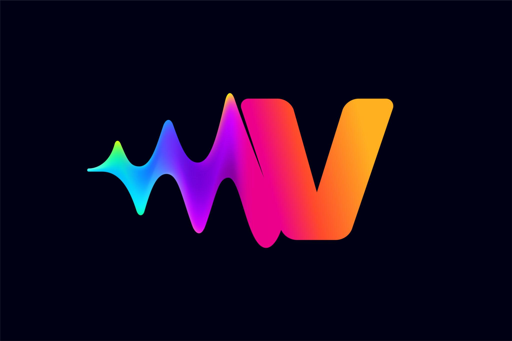
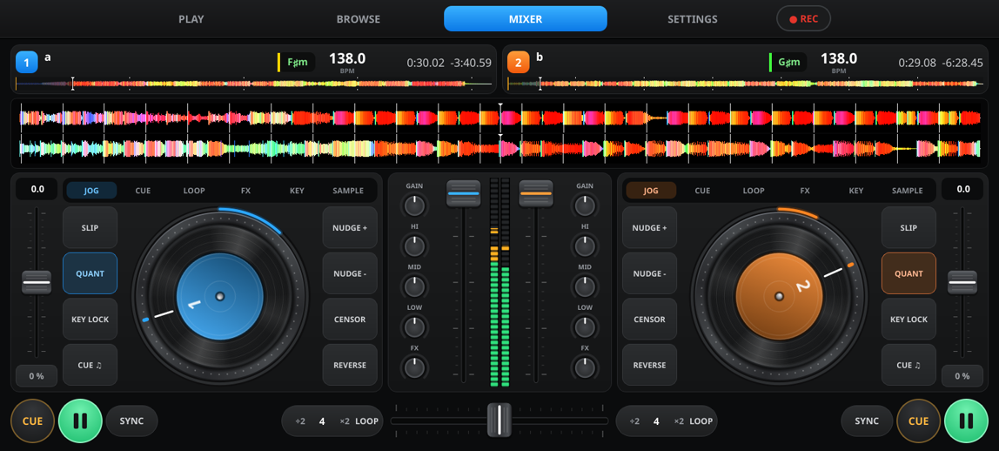

<p align="center">
  
</p>

<h1 align="center">Vynix DJ</h1>

<p align="center">
  Biến DJ controller của bạn thành <b>máy DJ all-in-one</b>.<br>
  Phần mềm DJ mã nguồn mở cho Android, iOS, Windows, Linux và macOS, thiết kế cho màn hình
  cảm ứng và DJ controller USB. Phát triển từ <a href="https://mixxx.org">Mixxx</a>.
</p>

<p align="center">
  <a href="https://vynixdj.web.app/"><b>Website: vynixdj.web.app</b></a>
</p>

<p align="center">
  <a href="README.md">English</a> · <b>Tiếng Việt</b>
</p>

<p align="center">
  
</p>

---

## Vynix DJ là gì?

Các máy all-in-one như dòng Pioneer XDJ hay Denon DJ Prime gộp deck, mixer và màn hình
vào một khối, chơi nhạc không cần laptop. Vynix DJ giúp bạn tự làm một máy như vậy từ
một DJ controller USB thông thường: gắn thêm điện thoại, máy tính bảng, máy tính nhúng
có màn hình cảm ứng hoặc một PC nhỏ, controller sẽ trở thành một bộ DJ hoàn chỉnh.

- **Dành cho dân mod.** Giao diện thiết kế cho màn hình gắn trên hoặc cạnh controller:
  nút bấm lớn, hiển thị toàn màn hình, điều khiển ưu tiên bằng controller, có thể chơi
  cả set chỉ bằng controller.
- **Chạy trên thiết bị bạn có.** Cùng một phần mềm và giao diện trên Android, iPhone và
  iPad, Windows, Linux (x64 và ARM64) và macOS. Chọn phần cứng phù hợp với bản mod của bạn.
- **Cắm là chạy.** Có sẵn hơn 140 mapping controller từ Mixxx, mapping được tự chọn
  khi cắm controller.
- **Dùng thư viện nhạc sẵn có.** Phát nhạc từ thư mục trên máy hoặc từ USB Rekordbox,
  giữ nguyên playlist, cue, loop và beatgrid.

> **2 hoặc 4 deck.** Chuyển ở **SETTINGS → GENERAL → DECKS**. Mặc định là 2 deck, hợp
> với màn hình nhỏ nhất.

## Gợi ý cấu hình

| Cấu hình | Nền tảng | Ghi chú |
|---|---|---|
| Controller + điện thoại hoặc máy tính bảng | Android | Nối controller qua cáp hoặc hub USB OTG. Gọn nhất. |
| Controller + iPhone hoặc iPad | iOS | Nối qua USB-C, hoặc Lightning với đầu chuyển camera. Chỉ controller MIDI. |
| Controller + máy tính ARM64 có màn hình cảm ứng (ví dụ Raspberry Pi) | Linux ARM64 | Làm thành máy cố định "kiểu XDJ", có thể lắp bo mạch vào hộp. |
| Controller + mini PC hoặc laptop cũ | Windows / Linux x64 | Mạnh nhất, hợp với thư viện nhạc lớn. |
| Controller + Mac | macOS | Mac chip Apple Silicon. |

## Tính năng

**Deck** (tab PLAY)
- 2 hoặc 4 deck với sóng nhạc màu (RGB / Filtered / HSV), beatgrid, cue, hot cue và loop.
- Phóng to / thu nhỏ sóng nhạc bằng hai ngón tay, hoặc Shift + núm browse trên nhiều
  controller.
- Giao diện cảm ứng co giãn theo màn hình điện thoại, máy tính bảng và máy tính, hiển
  thị toàn màn hình, kể cả vùng tai thỏ trên điện thoại.

**Mixer** (tab MIXER), bố cục kiểu app DJ trên điện thoại và máy tính bảng
- Đĩa xoay có ảnh bìa: kéo mặt đĩa để cào (scratch), kéo viền đĩa để đẩy nhịp (nudge).
  Vòng ngoài cho biết vị trí trong bài.
- Mỗi deck chuyển được giữa đĩa xoay, 8 hot cue, loop và nhảy nhịp, hiệu ứng, key (đổi
  tông, key lock, match) và 8 pad sample.
- Núm GAIN, EQ HI / MID / LOW và FX, fader kênh và tempo, VU, crossfader, CUE / PLAY /
  SYNC và loop chỉnh được độ dài. Chạm đúp vào núm để về mặc định.
- Sóng nhạc chạy, sóng tổng quan, key, BPM và thời gian của các deck trên cùng một trang.
- Khi dùng 4 deck: 4 sóng nhạc, 4 fader âm lượng và VU, nút **1 | 3** và **2 | 4** chọn
  deck ở mỗi bên.
- **Sound Color FX** như trên mixer Pioneer XDJ: FILTER, SPACE, DUB ECHO, SWEEP, NOISE
  và CRUSH chọn hiệu ứng cho núm FX của tất cả các deck.

**Thu âm**
- Nút **REC** trên mọi trang để thu bản mix ra MP3, WAV hoặc FLAC. Trên Android file nằm
  ở `Music/Vynix DJ` và hiện trong các app nghe nhạc khác, trên máy tính ở
  `Music/Vynix DJ/Recordings`.

**Beat FX** (tab PLAY)
- Bộ hiệu ứng kiểu phần cứng: chọn hiệu ứng trong màn hình chọn toàn màn hình, bật và
  chỉnh núm BEAT, LEVEL. LEVEL về 0 mỗi khi chọn hiệu ứng mới.
- Echo, Reverb, Flanger, Phaser, Filter, Trans, Pan, Glitch, Pitch, Bitcrusher và Noise.
- Một bộ FX (kiểu DDJ) hoặc hai bộ (kiểu Denon DJ / Numark).

**Thư viện nhạc**
- Thư mục nhạc trên thiết bị hoặc máy tính, có tìm kiếm và bảng thông tin bài hát: ảnh
  bìa, BPM, key, thời lượng, sóng nhạc tổng quan và nút LOAD cho từng deck.
- USB Rekordbox: playlist, cue, loop và beatgrid từ USB đã export bằng Rekordbox.
  Rekordbox và Serato nằm ngay sau mục Tracks.

**Controller**
- Controller USB MIDI, trên điện thoại và máy tính bảng dùng Android MIDI API.
- Controller USB HID / Bulk (một số dòng Traktor, Hercules, Denon, …).
- Tự chọn mapping trong các mapping có sẵn của Mixxx (Pioneer DDJ, Denon MC, Numark,
  Hercules, Roland, …).
- Import mapping của cộng đồng (`.xml`, `.js` hoặc file `.zip` chứa cả hai) ngay trong
  app, kể cả trên Android, nơi không mở được thư mục mapping.
- Điều khiển ưu tiên bằng controller: xoay núm browse sẽ mở thư viện, nhấn núm để vào
  thư mục và playlist, nút back để quay ra, load bài xong tự quay về màn deck.

**Cài đặt**
- Các trang cài đặt trong app dành cho màn hình cảm ứng, cùng hộp thoại Preferences đầy
  đủ với chữ lớn và vuốt để cuộn.

## Yêu cầu

- **Android:** Android 9 (API 28) trở lên, CPU **arm64-v8a**. Cần quyền **truy cập mọi
  tệp** để đọc nhạc và cáp hoặc đầu chuyển **USB OTG** để nối controller.
- **iOS:** iPhone hoặc iPad chạy iOS / iPadOS 16 trở lên, và một máy tính để cài app.
- **Windows:** Windows 10 trở lên, 64-bit.
- **Linux:** các bản phân phối dựa trên Debian / Ubuntu, x86_64 hoặc ARM64.
- **macOS:** macOS 11 trở lên, chip Apple Silicon (M1 trở lên).

## Cài đặt

Tải bản cho nền tảng của bạn ở trang
[Releases](https://github.com/thanhtonvk/Vynix-DJ/releases):

| Nền tảng | File |
|---|---|
| Android | `VynixDJ-<version>-android-arm64.apk` |
| iOS / iPadOS | `VynixDJ-<version>-ios-unsigned.ipa` |
| Windows | `VynixDJ-<version>-windows-x64.msi` |
| Linux (PC) | `VynixDJ-<version>-linux-x64.deb` |
| Linux (ARM64, ví dụ Raspberry Pi) | `VynixDJ-<version>-linux-arm64.deb` |
| macOS (Apple Silicon) | `VynixDJ-<version>-macos-arm64.dmg` |

**Android:** mở file APK trên thiết bị và cho phép cài ứng dụng từ nguồn không xác định,
hoặc cài từ máy tính bằng `adb install VynixDJ-<version>-android-arm64.apk`. Mở Vynix DJ
và cấp quyền truy cập tệp khi được hỏi.

**iOS / iPadOS:** app không có trên App Store, bạn tự ký và cài bằng Apple ID của mình.
Không cần jailbreak.

1. Cài [Sideloadly](https://sideloadly.io) trên máy Windows hoặc Mac (trên Windows cần thêm
   iTunes và iCloud tải từ apple.com, không dùng bản Microsoft Store). Cắm iPhone hoặc iPad
   bằng cáp và chọn **Tin cậy** trên máy.
2. Kéo file IPA vào Sideloadly, nhập Apple ID rồi bấm **Start**.
3. Trên iPhone, bật **Cài đặt → Quyền riêng tư & Bảo mật → Chế độ nhà phát triển** và khởi
   động lại máy.
4. **Cài đặt → Cài đặt chung → VPN & Quản lý thiết bị** → Apple ID của bạn → **Tin cậy**.
5. Mở Vynix DJ. Sau đó dùng app **Tệp (Files)** chép nhạc vào **Trên iPhone → Vynix DJ →
   Music** (hoặc dùng Finder / iTunes) rồi mở lại Vynix DJ.

Với Apple ID miễn phí, cứ 7 ngày phải ký lại (cài lại IPA như trên, thư viện nhạc vẫn giữ)
và mỗi máy chỉ cài được 3 app như vậy. [AltStore](https://altstore.io) và
[SideStore](https://sidestore.io) có thể tự gia hạn. Với tài khoản Apple Developer trả phí
thì dùng được một năm.

**Windows:** mở file MSI và làm theo trình cài đặt, rồi mở Vynix DJ từ menu Start hoặc
desktop. Bộ cài chưa được ký: nếu SmartScreen chặn, chọn **More info** → **Run anyway**.
Cài Vynix DJ không ảnh hưởng tới Mixxx đã cài.

**Linux:** `sudo apt install ./VynixDJ-<version>-linux-x64.deb` (hoặc gói ARM64), rồi
mở Vynix DJ từ menu ứng dụng.

**macOS:** mở file DMG và kéo **VynixDJ** vào **Applications**. App chưa được ký bằng
Apple Developer ID nên lần đầu mở macOS sẽ chặn: chuột phải vào app → **Open** →
**Open**, hoặc chạy `xattr -dr com.apple.quarantine /Applications/VynixDJ.app`.

## Bắt đầu nhanh

**DJ controller**

- Cắm controller **trước khi** mở Vynix DJ. Controller có mapping sẵn sẽ được bật tự
  động.
- Nếu cắm controller khi app đang chạy, app sẽ báo cần khởi động lại.
- Chọn mapping thủ công: **SETTINGS → DEVICE → DJ controllers → OPEN**.
- Dùng mapping không có sẵn trong Mixxx, ví dụ từ
  [forum Mixxx](https://mixxx.discourse.group/c/controller-mappings/10): tải về, bấm
  **Import...** cạnh **Load Mapping** rồi chọn file `.zip` hoặc các file `.xml` và `.js`.
  Chọn mapping vừa import và bấm **Apply**.

**Nhạc**

- Trên Android, chép nhạc vào thư mục `Music` hoặc `Download`; cả hai được quét ở lần
  mở đầu tiên. Trên máy tính, app dùng thư mục `Music` của bạn.
- Thêm thư mục khác: **SETTINGS → DEVICE → Music library → OPEN → Add**.
- Mở **BROWSE → TRACKS** (hoặc xoay núm browse), chọn bài rồi bấm **LOAD 1** /
  **LOAD 2**, chạm 2 lần vào bài, hoặc dùng nút load trên controller.
- Dùng 4 deck: **SETTINGS → GENERAL → DECKS → 4 DECKS**.

**Mix** (tab MIXER)

- Kéo mặt đĩa để cào (scratch), kéo viền đĩa để đẩy nhịp (nudge).
- Thanh tab phía trên đĩa chuyển sang hot cue, loop và nhảy nhịp, hiệu ứng, key hoặc pad
  sample.
- Núm GAIN, HI / MID / LOW và FX (chạm đúp để về giữa), fader tempo và volume, CUE /
  PLAY / SYNC, loop chỉnh được độ dài và crossfader.
- **FX → COLOR FX** chọn hiệu ứng cho núm FX. Núm ở giữa là tắt; FILTER cắt tiếng cao
  hoặc tiếng trầm, các hiệu ứng khác mạnh dần về hai phía.
- Khi dùng 4 deck, **1 | 3** và **2 | 4** chọn deck hiện ở mỗi bên.
- Nút **REC** phía trên để thu bản mix. Định dạng ở **SETTINGS → GENERAL → RECORDING**.

**Beat FX** (tab PLAY, khung bên phải)

1. Chạm vào tên hiệu ứng để mở màn hình chọn, rồi chọn hiệu ứng.
2. Chọn các deck để áp dụng.
3. Bấm **FX ON**, rồi vặn **LEVEL** lên và chỉnh **BEAT**.
4. Một hay hai bộ FX: **SETTINGS → GENERAL → FX units**.

**Âm thanh**

- Chọn sound card, độ trễ hoặc sample rate: **SETTINGS → AUDIO → OPEN**. Trên Android,
  mặc định phát ra loa hoặc tai nghe của thiết bị qua Oboe/AAudio.
- Âm lượng master, booth, tai nghe và EQ master nằm ở **SETTINGS → AUDIO**.
- Sampler nằm ở **SETTINGS → SAMPLER**.

## Build từ mã nguồn

### Windows, Linux, macOS và iOS

Các bản Windows (x64), Linux (x64, ARM64), macOS (arm64) và iOS được build bằng GitHub
Actions, xem [`.github/workflows`](.github/workflows). Push một tag `v*` sẽ build tất
cả và đính vào release. Xem [CONTRIBUTING.md](CONTRIBUTING.md) để build bản desktop trên
máy của bạn.

### Android

Yêu cầu: Linux x86_64 (hoặc WSL 2 trên Windows), CMake ≥ 3.22, Ninja, JDK 17, Android SDK
(platform 35, build-tools 35.0.0) và NDK 27.2.12479018.

```bash
# 1. Cài Android SDK/NDK và tải thư viện build sẵn (vcpkg) cho arm64-android
source tools/android_buildenv.sh setup

# 2. Tạo khóa ký APK (chỉ một lần)
keytool -genkey -keystore vynixdj.keystore -alias vynixdj -keyalg RSA \
        -keysize 2048 -validity 10000
export QT_ANDROID_KEYSTORE_PATH=$PWD/vynixdj.keystore
export QT_ANDROID_KEYSTORE_ALIAS=vynixdj
export QT_ANDROID_KEYSTORE_STORE_PASS=<mật khẩu>
export QT_ANDROID_KEYSTORE_KEY_PASS=<mật khẩu>

# 3. Cấu hình và build
mkdir -p build && cd build
cmake -G Ninja \
      -DCMAKE_TOOLCHAIN_FILE=$MIXXX_VCPKG_ROOT/scripts/buildsystems/vcpkg.cmake \
      -DCMAKE_SYSTEM_NAME=Android \
      -DVCPKG_TARGET_TRIPLET=arm64-android \
      -DCMAKE_BUILD_TYPE=RelWithDebInfo \
      -DQT6=ON -DHID=ON -DBULK=ON \
      -DBUILD_TESTING=OFF -DBUILD_BENCH=OFF \
      -DCMAKE_CXX_SCAN_FOR_MODULES=OFF \
      ..
cmake --build . --parallel

# File APK (khoảng 57 MB) nằm ở:
# build/android-build/build/outputs/apk/release/android-build-release-signed.apk
```

Bước `setup` cần `sudo` để cài gói và tải khoảng 15 GB thư viện. Với CMake 3.28 trở lên
cần `-DCMAKE_CXX_SCAN_FOR_MODULES=OFF` vì NDK không có `clang-scan-deps`.

Bản build chỉ dành cho arm64. Máy ảo Android x86_64 chạy **Android 11 trở lên** vẫn
chạy được nhờ dịch lệnh ARM, nhưng chậm hơn máy thật:

```bash
sdkmanager "system-images;android-34;google_apis;x86_64" "emulator"
avdmanager create avd -n vynix -k "system-images;android-34;google_apis;x86_64" -d pixel_8
emulator -avd vynix -gpu host &
adb install -r build/android-build/build/outputs/apk/release/android-build-release-signed.apk
```

## Khác biệt so với Mixxx

| Thành phần | Thay đổi chính |
|---|---|
| `res/skins/VynixDJ/` | Skin cảm ứng: 2 hoặc 4 deck, tab MIXER với đĩa xoay và Sound Color FX, màn hình chọn Beat FX, bảng thông tin bài hát |
| `src/controllers/controllermanager.cpp` | Tự bật controller mới và chọn mapping theo tên |
| `src/controllers/controllermappingimport.*` | Import file mapping và file ZIP vào thư mục mapping của người dùng |
| `src/controllers/midi/androidmidi*` | Backend MIDI cho Android (`android.media.midi`) |
| `src/library/` | Điều khiển thư viện bằng controller, tìm kiếm từ sidebar, Rekordbox / Serato lên đầu |
| `src/effects/` | Núm Beat FX, control `beat_period`, BQ EQ làm EQ mặc định của deck |
| `src/widget/wjogwheel.*` | Đĩa xoay cảm ứng, cào và đẩy nhịp |
| `src/widget/` | Phóng to sóng nhạc bằng hai ngón tay, chạm đúp để đưa núm và fader về mặc định |
| `src/mixer/playermanager.*` | Chọn bài nhẹ hơn: nghe thử và phân tích trễ lại trên máy yếu |
| `src/recording/` | Thư mục và định dạng thu âm cho skin cảm ứng |
| `src/preferences/dialog/dlgpreferences.cpp` | Preferences chữ lớn, vuốt để cuộn |
| `src/soundio/` | Nhận loa trong của Android, chọn Oboe và đầu ra mặc định |
| `packaging/android/src/com/tondz/vynixdj/` | `MidiBridge` (MIDI), `StorageVolumes` (USB), `Recordings` (quét media), `MainActivity` (toàn màn hình) |
| `packaging/android/build.gradle`, `libmixxx.map` | APK nhỏ: nén thư viện, bỏ QML, bỏ mã không dùng |
| `packaging/wix/` | Bộ cài MSI cho Windows |
| `src/util/androidlibccompat.c` | Các hàm libc thiếu trên Android 9–13 |

Ngoài ra có nhiều bản sửa lỗi cho Mixxx trên Android: crash khi mở trên Android 9–13,
sóng nhạc trống, không có tiếng, không thấy USB Rekordbox, hiệu ứng và font không tải
được từ APK. Trên mọi nền tảng, file không đọc được hoặc hỏng trên USB Rekordbox không còn
làm app bị crash.

## Hạn chế hiện tại

- Dùng 4 deck nên có màn hình cỡ máy tính bảng hoặc laptop.
- Bản Windows, macOS và iOS chưa được ký.
- iOS: chưa hỗ trợ controller HID / Bulk, USB Rekordbox và Apple Music. Chưa được thử trên
  nhiều máy.
- Controller có sound card riêng (ví dụ Denon MC7000) trên Android có thể chỉ phát được
  đường Master; chưa hỗ trợ nghe thử (cue) tai nghe riêng.
- Controller cắm vào khi app đang chạy chỉ được nhận sau khi khởi động lại app.

## Đóng góp

Vynix DJ là dự án độc lập, không thuộc đội phát triển Mixxx. Vui lòng báo lỗi và đề xuất
tính năng ở [Issues](https://github.com/thanhtonvk/Vynix-DJ/issues), **không** gửi lên
các kênh của Mixxx. Bạn cũng có thể khoe ảnh và mô tả bản mod all-in-one của mình ở đó.

Các bản sửa lỗi chung không gắn với giao diện Vynix DJ có thể đóng góp ngược lại cho
Mixxx theo hướng dẫn trong [CONTRIBUTING.md](CONTRIBUTING.md).

## Ghi công

- **[Mixxx](https://mixxx.org)**: engine âm thanh, thư viện nhạc, mapping controller và
  toàn bộ nền tảng. © Mixxx Development Team.

"Mixxx" là nhãn hiệu của dự án Mixxx. Vynix DJ là một bản phái sinh độc lập, không được
dự án Mixxx xác nhận hay tài trợ.

## Giấy phép

Vynix DJ phát hành theo **GNU General Public License, phiên bản 2 trở lên**, giống
Mixxx. Xem [LICENSE](LICENSE) và [COPYING](COPYING). Giấy phép và thông tin bản quyền
của skin VynixDJ nằm ở [`res/skins/VynixDJ/LICENSE`](res/skins/VynixDJ/LICENSE).
