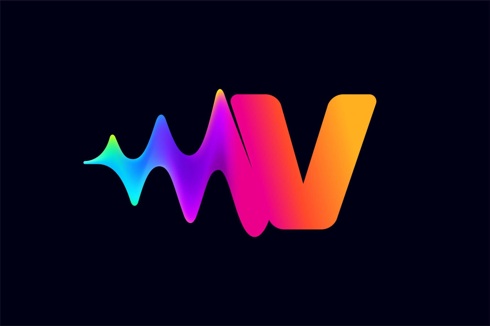
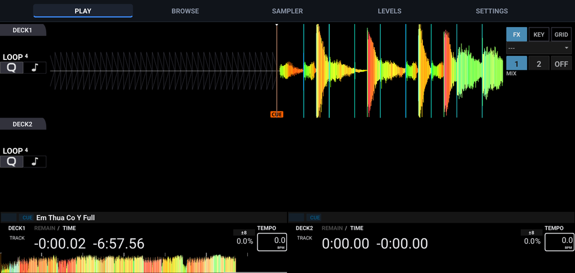

<p align="center">
  
</p>

<h1 align="center">Vynix DJ</h1>

<p align="center">
  Biến DJ controller của bạn thành <b>máy DJ all-in-one</b>.<br>
  Phần mềm DJ mã nguồn mở cho Android, Windows, Linux và macOS, thiết kế cho màn hình
  cảm ứng và DJ controller USB. Phát triển từ <a href="https://mixxx.org">Mixxx</a>.
</p>

<p align="center">
  <a href="README.md">English</a> · <b>Tiếng Việt</b>
</p>

<p align="center">
  
</p>

---

## Vynix DJ là gì?

Các máy all-in-one như dòng Pioneer XDJ hay Denon DJ Prime gộp deck, mixer và màn hình
vào một khối, chơi nhạc không cần laptop. Vynix DJ giúp bạn tự làm một máy như vậy từ
một DJ controller USB thông thường: gắn thêm điện thoại, máy tính bảng, máy tính nhúng
có màn hình cảm ứng hoặc một PC nhỏ, controller sẽ trở thành một bộ DJ hoàn chỉnh.

- **Dành cho dân mod.** Giao diện thiết kế cho màn hình gắn trên hoặc cạnh controller:
  nút bấm lớn, hiển thị toàn màn hình, điều khiển ưu tiên bằng controller, có thể chơi
  cả set chỉ bằng controller.
- **Chạy trên thiết bị bạn có.** Cùng một phần mềm và giao diện trên Android, Windows,
  Linux (x64 và ARM64) và macOS. Chọn phần cứng phù hợp với bản mod của bạn.
- **Cắm là chạy.** Có sẵn hơn 140 mapping controller từ Mixxx, mapping được tự chọn
  khi cắm controller.
- **Dùng thư viện nhạc sẵn có.** Phát nhạc từ thư mục trên máy hoặc từ USB Rekordbox,
  giữ nguyên playlist, cue, loop và beatgrid.

> **Hai deck.** Hiện tại Vynix DJ hỗ trợ **2 deck**. Controller 4 deck vẫn dùng được,
> nhưng giao diện chỉ hiển thị và mix deck 1 và 2.

## Gợi ý cấu hình

| Cấu hình | Nền tảng | Ghi chú |
|---|---|---|
| Controller + điện thoại hoặc máy tính bảng | Android | Nối controller qua cáp hoặc hub USB OTG. Gọn nhất. |
| Controller + máy tính ARM64 có màn hình cảm ứng (ví dụ Raspberry Pi) | Linux ARM64 | Làm thành máy cố định "kiểu XDJ", có thể lắp bo mạch vào hộp. |
| Controller + mini PC hoặc laptop cũ | Windows / Linux x64 | Mạnh nhất, hợp với thư viện nhạc lớn. |
| Controller + Mac | macOS | Mac chip Apple Silicon. |

## Tính năng

**Deck**
- Hai deck với sóng nhạc màu (RGB / Filtered / HSV), beatgrid, cue, hot cue và loop.
- Phóng to / thu nhỏ sóng nhạc bằng hai ngón tay.
- Giao diện cảm ứng co giãn theo màn hình điện thoại, máy tính bảng và máy tính, hiển
  thị toàn màn hình, kể cả vùng tai thỏ trên điện thoại.

**Mixer** (tab MIXER)
- GAIN, fader tempo kèm % tempo và nút về 0 %, fader kênh, fader EQ LOW / MID / HI và
  FX, VU master, CUE / PLAY / SYNC và crossfader cho cả hai deck.
- **Sound Color FX** như trên mixer Pioneer XDJ: FILTER, SPACE, DUB ECHO, SWEEP, NOISE
  và CRUSH chọn hiệu ứng cho fader FX của cả hai deck.
- Chạm 2 lần vào fader EQ hoặc FX để đưa về giữa.

**Beat FX** (tab PLAY)
- Bộ hiệu ứng kiểu phần cứng: chọn hiệu ứng trong màn hình chọn toàn màn hình, bật và
  chỉnh núm BEAT, LEVEL. LEVEL về 0 mỗi khi chọn hiệu ứng mới.
- Echo, Reverb, Flanger, Phaser, Filter, Trans, Pan, Glitch, Pitch, Bitcrusher và Noise.
- Một bộ FX (kiểu DDJ) hoặc hai bộ (kiểu Denon DJ / Numark).

**Thư viện nhạc**
- Thư mục nhạc trên thiết bị hoặc máy tính, có tìm kiếm và bảng thông tin bài hát: ảnh
  bìa, BPM, key, thời lượng, sóng nhạc tổng quan và nút LOAD 1 / LOAD 2.
- USB Rekordbox: playlist, cue, loop và beatgrid từ USB đã export bằng Rekordbox.
  Rekordbox và Serato nằm ngay sau mục Tracks.

**Controller**
- Controller USB MIDI, trên điện thoại và máy tính bảng dùng Android MIDI API.
- Controller USB HID / Bulk (một số dòng Traktor, Hercules, Denon, …).
- Tự chọn mapping trong các mapping có sẵn của Mixxx (Pioneer DDJ, Denon MC, Numark,
  Hercules, Roland, …).
- Import mapping của cộng đồng (`.xml`, `.js` hoặc file `.zip` chứa cả hai) ngay trong
  app, kể cả trên Android, nơi không mở được thư mục mapping.
- Điều khiển ưu tiên bằng controller: xoay núm browse sẽ mở thư viện, load bài xong tự
  quay về màn deck.

**Cài đặt**
- Các trang cài đặt trong app dành cho màn hình cảm ứng, cùng hộp thoại Preferences đầy
  đủ với chữ lớn và vuốt để cuộn.

## Yêu cầu

- **Android:** Android 9 (API 28) trở lên, CPU **arm64-v8a**. Cần quyền **truy cập mọi
  tệp** để đọc nhạc và cáp hoặc đầu chuyển **USB OTG** để nối controller.
- **Windows:** Windows 10 trở lên, 64-bit.
- **Linux:** các bản phân phối dựa trên Debian / Ubuntu, x86_64 hoặc ARM64.
- **macOS:** macOS 11 trở lên, chip Apple Silicon (M1 trở lên).

## Cài đặt

Tải bản cho nền tảng của bạn ở trang
[Releases](https://github.com/thanhtonvk/Vynix-DJ/releases):

| Nền tảng | File |
|---|---|
| Android | `VynixDJ-<version>-android-arm64.apk` |
| Windows | `VynixDJ-<version>-windows-x64.zip` |
| Linux (PC) | `VynixDJ-<version>-linux-x64.deb` |
| Linux (ARM64, ví dụ Raspberry Pi) | `VynixDJ-<version>-linux-arm64.deb` |
| macOS (Apple Silicon) | `VynixDJ-<version>-macos-arm64.dmg` |

**Android:** mở file APK trên thiết bị và cho phép cài ứng dụng từ nguồn không xác định,
hoặc cài từ máy tính bằng `adb install VynixDJ-<version>-android-arm64.apk`. Mở Vynix DJ
và cấp quyền truy cập tệp khi được hỏi.

**Windows:** giải nén file zip và chạy `VynixDJ.exe`.

**Linux:** `sudo apt install ./VynixDJ-<version>-linux-x64.deb` (hoặc gói ARM64), rồi
mở Vynix DJ từ menu ứng dụng.

**macOS:** mở file DMG và kéo **VynixDJ** vào **Applications**. App chưa được ký bằng
Apple Developer ID nên lần đầu mở macOS sẽ chặn: chuột phải vào app → **Open** →
**Open**, hoặc chạy `xattr -dr com.apple.quarantine /Applications/VynixDJ.app`.

## Bắt đầu nhanh

**DJ controller**

- Cắm controller **trước khi** mở Vynix DJ. Controller có mapping sẵn sẽ được bật tự
  động.
- Nếu cắm controller khi app đang chạy, app sẽ báo cần khởi động lại.
- Chọn mapping thủ công: **SETTINGS → DEVICE → DJ controllers → OPEN**.
- Dùng mapping không có sẵn trong Mixxx, ví dụ từ
  [forum Mixxx](https://mixxx.discourse.group/c/controller-mappings/10): tải về, bấm
  **Import...** cạnh **Load Mapping** rồi chọn file `.zip` hoặc các file `.xml` và `.js`.
  Chọn mapping vừa import và bấm **Apply**.

**Nhạc**

- Trên Android, chép nhạc vào thư mục `Music` hoặc `Download`; cả hai được quét ở lần
  mở đầu tiên. Trên máy tính, app dùng thư mục `Music` của bạn.
- Thêm thư mục khác: **SETTINGS → DEVICE → Music library → OPEN → Add**.
- Mở **BROWSE → TRACKS** (hoặc xoay núm browse), chọn bài rồi bấm **LOAD 1** /
  **LOAD 2**, chạm 2 lần vào bài, hoặc dùng nút load trên controller.

**Mix** (tab MIXER)

- Fader tempo, volume, LOW / MID / HI và FX, núm GAIN, CUE / PLAY / SYNC và crossfader
  cho cả hai deck.
- Các nút ở giữa chọn hiệu ứng cho fader FX. Fader ở giữa là tắt; FILTER cắt tiếng cao
  hoặc tiếng trầm, các hiệu ứng khác mạnh dần khi kéo về hai phía.

**Beat FX** (tab PLAY, khung bên phải)

1. Chạm vào tên hiệu ứng để mở màn hình chọn, rồi chọn hiệu ứng.
2. Chọn **Deck 1** / **Deck 2** để áp dụng.
3. Bấm **FX ON**, rồi vặn **LEVEL** lên và chỉnh **BEAT**.
4. Một hay hai bộ FX: **SETTINGS → GENERAL → FX units**.

**Âm thanh**

- Chọn sound card, độ trễ hoặc sample rate: **SETTINGS → AUDIO → OPEN**. Trên Android,
  mặc định phát ra loa hoặc tai nghe của thiết bị qua Oboe/AAudio.
- Âm lượng master, booth, tai nghe và EQ master nằm ở **SETTINGS → AUDIO**.
- Sampler nằm ở **SETTINGS → SAMPLER**.

## Build từ mã nguồn

### Windows, Linux và macOS

Các bản Windows (x64), Linux (x64, ARM64) và macOS (arm64) được build bằng GitHub
Actions, xem [`.github/workflows`](.github/workflows). Push một tag `v*` sẽ build tất
cả và đính vào release. Xem [CONTRIBUTING.md](CONTRIBUTING.md) để build bản desktop trên
máy của bạn.

### Android

Yêu cầu: Linux x86_64 (hoặc WSL 2 trên Windows), CMake ≥ 3.22, Ninja, JDK 17, Android SDK
(platform 35, build-tools 35.0.0) và NDK 27.2.12479018.

```bash
# 1. Cài Android SDK/NDK và tải thư viện build sẵn (vcpkg) cho arm64-android
source tools/android_buildenv.sh setup

# 2. Tạo khóa ký APK (chỉ một lần)
keytool -genkey -keystore vynixdj.keystore -alias vynixdj -keyalg RSA \
        -keysize 2048 -validity 10000
export QT_ANDROID_KEYSTORE_PATH=$PWD/vynixdj.keystore
export QT_ANDROID_KEYSTORE_ALIAS=vynixdj
export QT_ANDROID_KEYSTORE_STORE_PASS=<mật khẩu>
export QT_ANDROID_KEYSTORE_KEY_PASS=<mật khẩu>

# 3. Cấu hình và build
mkdir -p build && cd build
cmake -G Ninja \
      -DCMAKE_TOOLCHAIN_FILE=$MIXXX_VCPKG_ROOT/scripts/buildsystems/vcpkg.cmake \
      -DCMAKE_SYSTEM_NAME=Android \
      -DVCPKG_TARGET_TRIPLET=arm64-android \
      -DCMAKE_BUILD_TYPE=RelWithDebInfo \
      -DQT6=ON -DQML=ON -DHID=ON -DBULK=ON \
      -DBUILD_TESTING=OFF -DBUILD_BENCH=OFF \
      -DCMAKE_CXX_SCAN_FOR_MODULES=OFF \
      ..
cmake --build . --parallel

# File APK nằm ở:
# build/android-build/build/outputs/apk/release/android-build-release-signed.apk
```

Bước `setup` cần `sudo` để cài gói và tải khoảng 15 GB thư viện. Với CMake 3.28 trở lên
cần `-DCMAKE_CXX_SCAN_FOR_MODULES=OFF` vì NDK không có `clang-scan-deps`.

Bản build chỉ dành cho arm64. Máy ảo Android x86_64 chạy **Android 11 trở lên** vẫn
chạy được nhờ dịch lệnh ARM, nhưng chậm hơn máy thật:

```bash
sdkmanager "system-images;android-34;google_apis;x86_64" "emulator"
avdmanager create avd -n vynix -k "system-images;android-34;google_apis;x86_64" -d pixel_8
emulator -avd vynix -gpu host &
adb install -r build/android-build/build/outputs/apk/release/android-build-release-signed.apk
```

## Khác biệt so với Mixxx

| Thành phần | Thay đổi chính |
|---|---|
| `res/skins/VynixDJ/` | Skin cảm ứng: tab MIXER với Sound Color FX, màn hình chọn Beat FX, bảng thông tin bài hát |
| `src/controllers/controllermanager.cpp` | Tự bật controller mới và chọn mapping theo tên |
| `src/controllers/controllermappingimport.*` | Import file mapping và file ZIP vào thư mục mapping của người dùng |
| `src/controllers/midi/androidmidi*` | Backend MIDI cho Android (`android.media.midi`) |
| `src/library/` | Điều khiển thư viện bằng controller, tìm kiếm từ sidebar, Rekordbox / Serato lên đầu |
| `src/effects/` | Núm Beat FX, control `beat_period`, BQ EQ làm EQ mặc định của deck |
| `src/widget/` | Phóng to sóng nhạc bằng hai ngón tay, chạm 2 lần để đưa fader về giữa |
| `src/preferences/dialog/dlgpreferences.cpp` | Preferences chữ lớn, vuốt để cuộn |
| `src/soundio/` | Nhận loa trong của Android, chọn Oboe và đầu ra mặc định |
| `packaging/android/src/com/tondz/vynixdj/` | `MidiBridge` (MIDI), `StorageVolumes` (USB), `MainActivity` (toàn màn hình) |
| `src/util/androidlibccompat.c` | Các hàm libc thiếu trên Android 9–13 |

Ngoài ra có nhiều bản sửa lỗi cho Mixxx trên Android: crash khi mở trên Android 9–13,
sóng nhạc trống, không có tiếng, không thấy USB Rekordbox, hiệu ứng và font không tải
được từ APK.

## Hạn chế hiện tại

- Chỉ hỗ trợ **2 deck**.
- Controller có sound card riêng (ví dụ Denon MC7000) trên Android có thể chỉ phát được
  đường Master; chưa hỗ trợ nghe thử (cue) tai nghe riêng.
- Controller cắm vào khi app đang chạy chỉ được nhận sau khi khởi động lại app.

## Đóng góp

Vynix DJ là dự án độc lập, không thuộc đội phát triển Mixxx. Vui lòng báo lỗi và đề xuất
tính năng ở [Issues](https://github.com/thanhtonvk/Vynix-DJ/issues), **không** gửi lên
các kênh của Mixxx. Bạn cũng có thể khoe ảnh và mô tả bản mod all-in-one của mình ở đó.

Các bản sửa lỗi chung không gắn với giao diện Vynix DJ có thể đóng góp ngược lại cho
Mixxx theo hướng dẫn trong [CONTRIBUTING.md](CONTRIBUTING.md).

## Ghi công

- **[Mixxx](https://mixxx.org)**: engine âm thanh, thư viện nhạc, mapping controller và
  toàn bộ nền tảng. © Mixxx Development Team.

"Mixxx" là nhãn hiệu của dự án Mixxx. Vynix DJ là một bản phái sinh độc lập, không được
dự án Mixxx xác nhận hay tài trợ.

## Giấy phép

Vynix DJ phát hành theo **GNU General Public License, phiên bản 2 trở lên**, giống
Mixxx. Xem [LICENSE](LICENSE) và [COPYING](COPYING). Giấy phép và thông tin bản quyền
của skin VynixDJ nằm ở [`res/skins/VynixDJ/LICENSE`](res/skins/VynixDJ/LICENSE).
